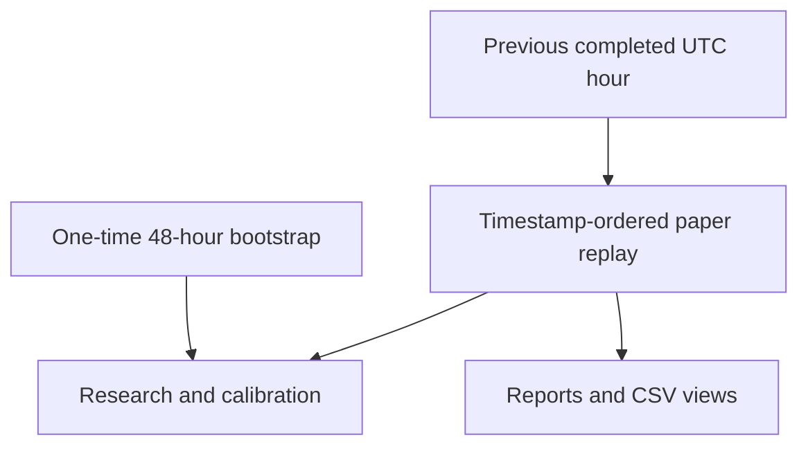

# Operations

- Venue: Polymarket US BTC 15-minute and 1-hour binary Up/Down markets.
- Collection: one CI run per hour fetches the previous fully closed UTC hour, then exits. Decisions follow the available historical price timestamps (at most once per account/market/minute).
- Accounts: thirteen isolated $100 simulated bankrolls. Order size uses one-quarter Kelly, capped at 10% of account equity per order and 30% total committed exposure; see [execution policy](EXECUTION.md#risk-and-lifecycle).
- Execution: delayed historical display-price paper proxy with slippage/taker fees, not executable book quotes; see [execution policy](EXECUTION.md).
- Research: chronological experiments on bootstrap plus officially settled observations; the separate backward archive stays untouched by training. See [research plan](RESEARCH.md).
- Persistence: GitHub repository state is canonical; CSV files and bot pages are generated views of JSON state.
- Automation: hourly GitHub Actions starts can be delayed or skipped. Each completed UTC hour is checkpointed to prevent duplicate paper trades.

The simulator has no authenticated trading path. New historical price-proxy fills cannot establish executable liquidity or real-world execution; old crossing-based trades retain their original assumptions. The five legacy neural checkpoints currently abstain; `market_implied` is a no-trade benchmark. The distance pair uses the same signal; momentum and reversion are sign-reversed variants. Thirteen accounts therefore do not represent thirteen independent, active hypotheses.

## Fees

The current documented schedule uses zero standard maker fee and no maker rebate. Straight taker fees use coefficient 0.0695 times contracts × price × (1 − price), where confirmed applicable. These assumptions are specific to the cited US schedule; verify the current official schedule before evaluating results.

- [US exchange notice, Oct. 23, 2026](https://polymarketexchange.com/files/notices/Exchange%20Notice%20-%20Amendment%20to%20Taker%20and%20Maker%20Rebate%20Tiers%20%282026.10.23%29.pdf)
- [CFTC filing](https://www.cftc.gov/filings/orgrules/rules09292630356.pdf)

## Flow

## Parallel pipeline

The collector fetches one historical hour, records a shared sequence and settlement checks, then exits. Six Actions shards replay the existing accounts, and one publish job verifies hashes, merges states, updates reports and commits once. Missing/inconsistent shards block publication. No new descendants are created.

Decisions are simulated in chronological observation order; no orders are sent to an exchange. Missing historical source data is reported rather than fabricated.

For a directory of generated account views and the relationships between related strategies, see the [strategy index](bots/README.md). The index does not duplicate live metrics. The roster is fixed; [new strategy descendants are disabled](RESEARCH.md#strategy-descendants-and-forks) pending offline evaluation and review.
