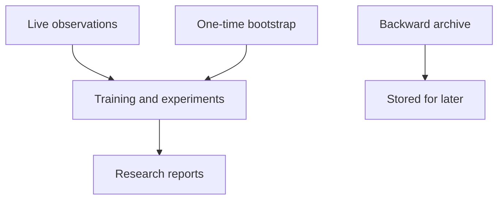

# Operations and research

- Observe 15-minute and 1-hour US BTC markets on a 15-second target cadence.
- Each bot has a decision opportunity every minute per market, including hold.
- Entries and exits are simulated resting limits. A later displayed book crossing with sufficient size is used as a fill proxy; queue position is unknown.
- Order sizing uses estimated edge and available cash, with a $15 maximum per order. The exchange's standard maker fee is zero; no rebate is assumed for these small accounts. Taker fees, when modeled, use the published straight-contract coefficient of 0.0695 per contract times p(1-p). [US exchange notice](https://polymarketexchange.com/files/notices/Exchange%20Notice%20-%20Amendment%20to%20Taker%20and%20Maker%20Rebate%20Tiers%20%282026.10.23%29.pdf), [CFTC filing](https://www.cftc.gov/filings/orgrules/rules09292630356.pdf).
- A one-time 48-hour bootstrap is stored with normal observations and labelled by official US settlement. It is obtained independently of the separate backward archive.
- Subsequent training consumes the fixed bootstrap and all usable settled live observations. The backward archive is never a trainer input.
- The deterministic research loop compares baseline, stronger regularization, and a nonlinear transform of exogenous returns against the market benchmark. It saves results per run. These are experiments, not an independent sealed holdout or an automatic strategy deployment.
- Optional Pi research uses OpenRouter's free router under the existing account limit, after its activation gate. A successful proposal is review-only.
- All decisions and orders are simulated. The trained research model is not yet connected to a paper account. CSV ledgers are generated views of the JSON state.
- Actions can start late and concurrent runs serialize. A cancelled job can lose uncommitted observations; failures attempt to preserve a temporary Actions artifact.
