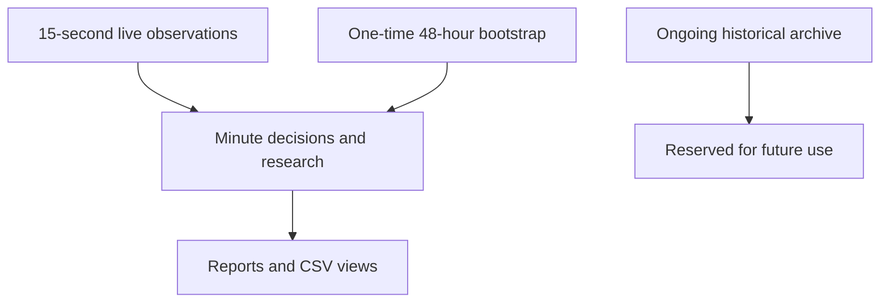

# Operations

- Venue: Polymarket US BTC 15-minute and 1-hour binary Up/Down markets.
- Collection target: one observation every 15 seconds; one optional action per account and market per minute.
- Accounts: thirteen isolated $100 simulated bankrolls. Order size uses one-quarter Kelly, capped at 5% of account equity per order and 20% total committed exposure; see [execution policy](EXECUTION.md#risk-and-lifecycle).
- Order execution: paper limit buys and simulated marketable exits. See [execution policy](EXECUTION.md) for actual fill proxy and the proposed urgent-exit experiment.
- Research: deterministic experiments on bootstrap plus settled live data; separate historical archive stays untouched by training. See [research plan](RESEARCH.md).
- Persistence: GitHub repository state is canonical; CSV files and bot pages are generated views of JSON state.
- Automation: hourly GitHub Actions runs can start late, queue, or fail. Uncommitted observations from a cancelled runner may be lost.

The simulator has no authenticated trading path. Its crossing-based fills do not model queue position or guarantee real-world executions. The five legacy neural checkpoints currently abstain; `market_implied` is a no-trade benchmark. The distance pair uses the same signal; momentum and reversion are sign-reversed variants. Thirteen accounts therefore do not represent thirteen independent, active hypotheses.

## Fees

The current documented schedule uses zero standard maker fee and no maker rebate. Straight taker fees use coefficient 0.0695 times contracts × price × (1 − price), where confirmed applicable. These assumptions are specific to the cited US schedule; verify the current official schedule before evaluating results.

- [US exchange notice, Oct. 23, 2026](https://polymarketexchange.com/files/notices/Exchange%20Notice%20-%20Amendment%20to%20Taker%20and%20Maker%20Rebate%20Tiers%20%282026.10.23%29.pdf)
- [CFTC filing](https://www.cftc.gov/filings/orgrules/rules09292630356.pdf)

## Flow

## Parallel pipeline

The collector records one shared sequence of observations and settlement checks. Six Actions jobs replay two accounts each using that sequence. One publish job verifies batch checksums, merges all six account results, updates research and reports, and commits state once. A missing or inconsistent shard stops publication. New descendants are not implemented yet.

Decisions are replayed after the collection hour, in observation order; no orders are sent to an exchange. Actions scheduling, artifact transfer and post-processing introduce collection gaps between runs.

For a directory of generated account views and the relationships between related strategies, see the [strategy index](bots/README.md). The index does not duplicate live metrics. The roster is fixed; [new strategy descendants are disabled](RESEARCH.md#strategy-descendants-and-forks) pending offline evaluation and review.
