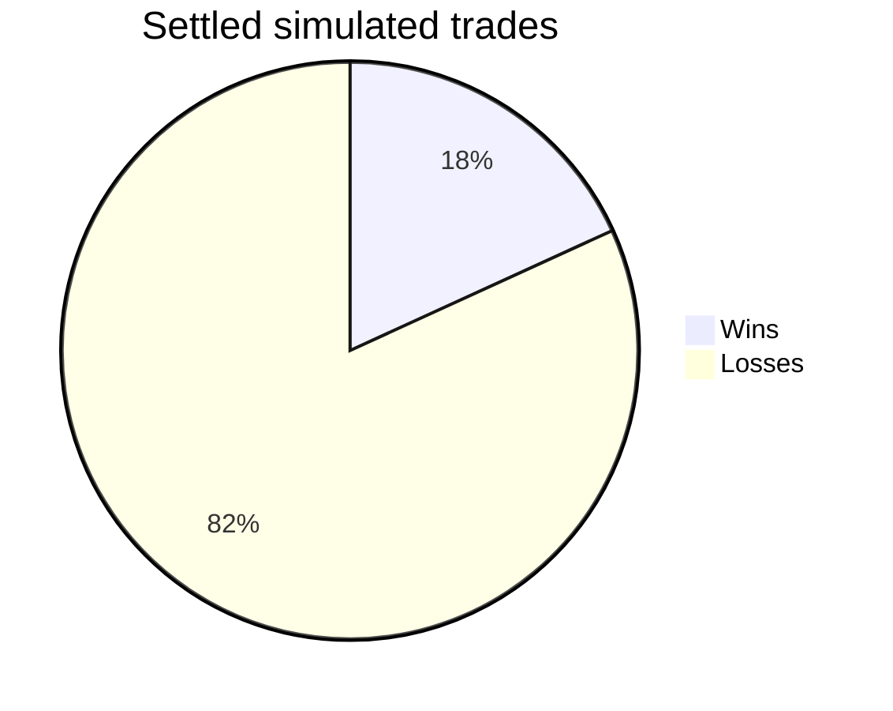

# book_imbalance

Paper account · simulated orders

| Metric | Value |
|---|---:|
| Cash | $68.58 |
| Reserved | $1.20 |
| Realized P&L | $-30.08 |
| Settled wins / losses | 6 / 27 |
| Open positions | 1 |
| Pending orders | 1 |
| Orders filled / placed | 58 / 69 |
| Recorded exit fees | $1.5571 |
| Calibration markets | 21 |
| Calibration logit offset | -0.0471 |
| Brier (markets) | 0.1012 (23) |
| ΔBrier vs market | -0.0033 |

[Order ledger](../../data/ledgers/book_imbalance-orders.csv) · [Trade ledger](../../data/ledgers/book_imbalance-trades.csv) · [Overview](../../REPORT.md)

## Results by market horizon

| Horizon | Closed trades | Realized P&L |
|---|---:|---:|
| 15m | 16 | $-13.90 |
| 1h | 17 | $-16.18 |

## Research

The shared research candidate is evaluated separately; it is not deployed to this account. [Latest experiments](../research/latest.md) · [Research plan](../RESEARCH.md)

Limit fills are estimates based on later observed book crossings; queue priority is unknown.
