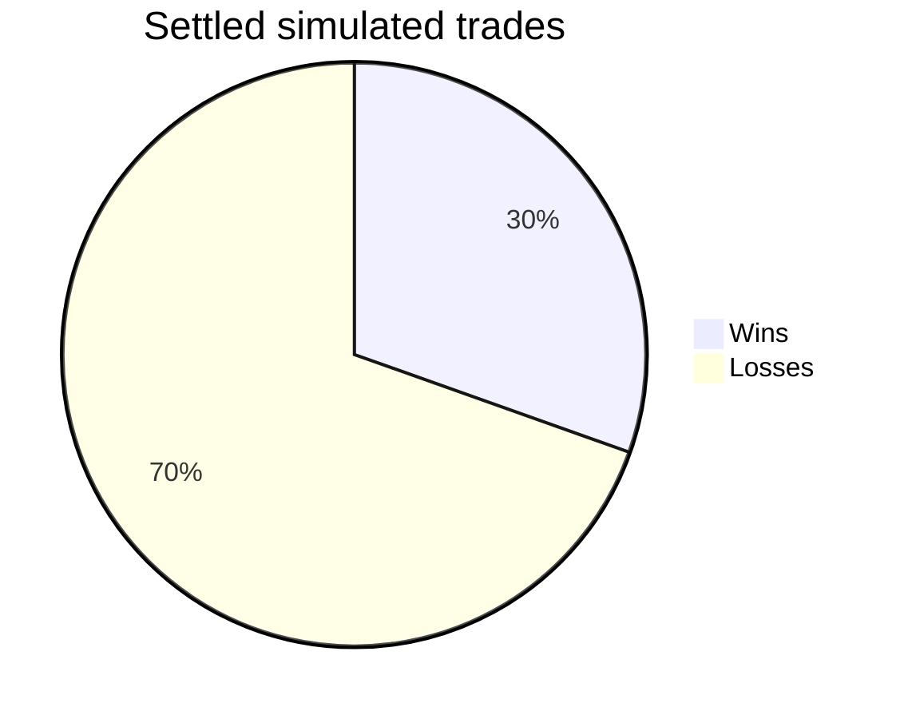

# book_imbalance

Paper account · simulated orders

| Metric | Value |
|---|---:|
| Cash | $62.30 |
| Reserved | $5.36 |
| Realized P&L | $-18.66 |
| Settled wins / losses | 14 / 32 |
| Open positions | 11 |
| Pending orders | 3 |
| Orders filled / placed | 89 / 107 |
| Recorded exit fees | $1.8853 |
| Calibration markets | 28 |
| Calibration logit offset | -0.1414 |
| Brier (markets) | 0.1132 (30) |
| ΔBrier vs market | +0.0007 |

[Order ledger](../../data/ledgers/book_imbalance-orders.csv) · [Trade ledger](../../data/ledgers/book_imbalance-trades.csv) · [Overview](../../REPORT.md)

## Results by market horizon

| Horizon | Closed trades | Realized P&L |
|---|---:|---:|
| 15m | 25 | $-3.41 |
| 1h | 21 | $-15.25 |

## Research

The shared research candidate is evaluated separately; it is not deployed to this account. [Latest experiments](../research/latest.md) · [Research plan](../RESEARCH.md)

Limit fills are estimates based on later observed book crossings; queue priority is unknown.
