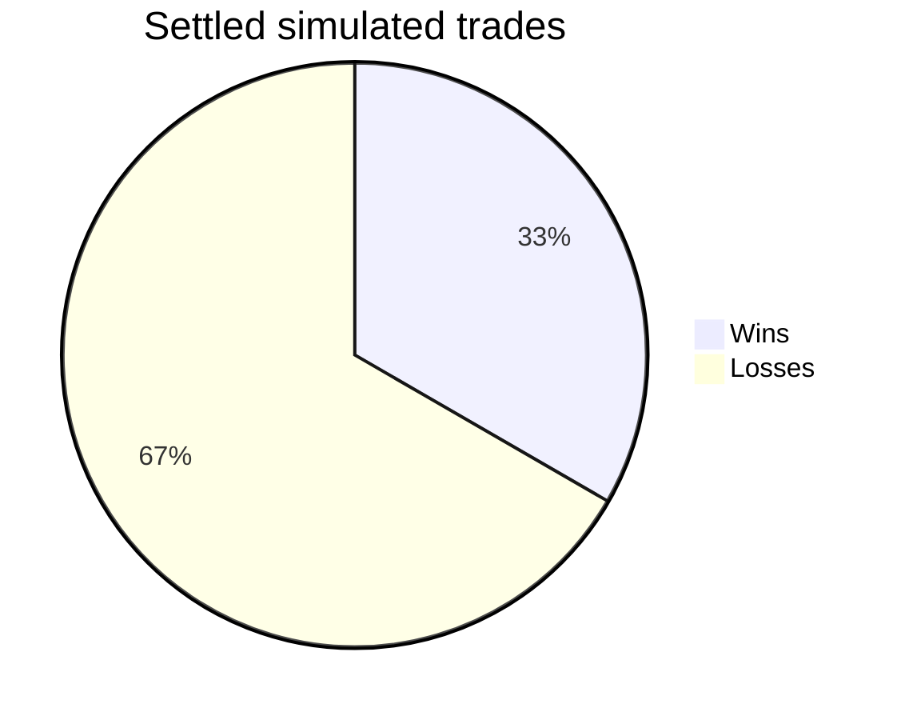

# brti_distance

Paper account · simulated orders

| Metric | Value |
|---|---:|
| Cash | $68.95 |
| Reserved | $0.00 |
| Realized P&L | $-1.50 |
| Settled wins / losses | 3 / 6 |
| Open positions | 3 |
| Pending orders | 0 |
| Orders filled / placed | 16 / 21 |
| Recorded exit fees | $1.0351 |
| Calibration markets | 8 |
| Calibration logit offset | +0.0017 |
| Brier (markets) | 0.0529 (10) |
| ΔBrier vs market | +0.0401 |

[Order ledger](../../data/ledgers/brti_distance-orders.csv) · [Trade ledger](../../data/ledgers/brti_distance-trades.csv) · [Overview](../../REPORT.md)

## Results by market horizon

| Horizon | Closed trades | Realized P&L |
|---|---:|---:|
| 15m | 6 | $-2.47 |
| 1h | 3 | $+0.97 |

## Research

The shared research candidate is evaluated separately; it is not deployed to this account. [Latest experiments](../research/latest.md) · [Research plan](../RESEARCH.md)

Limit fills are estimates based on later observed book crossings; queue priority is unknown.
