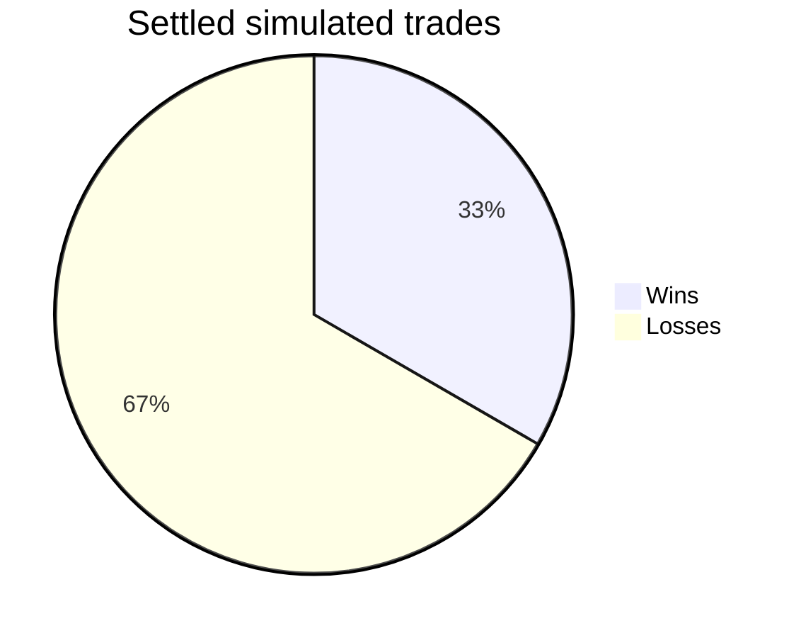

# brti_distance

Paper account · simulated orders

| Metric | Value |
|---|---:|
| Cash | $58.81 |
| Reserved | $7.35 |
| Realized P&L | $-26.48 |
| Settled wins / losses | 12 / 24 |
| Open positions | 2 |
| Pending orders | 1 |
| Orders filled / placed | 62 / 73 |
| Recorded exit fees | $5.6459 |
| Calibration markets | 21 |
| Calibration logit offset | -0.0318 |
| Brier (markets) | 0.0869 (23) |
| ΔBrier vs market | +0.0110 |

[Order ledger](../../data/ledgers/brti_distance-orders.csv) · [Trade ledger](../../data/ledgers/brti_distance-trades.csv) · [Overview](../../REPORT.md)

## Results by market horizon

| Horizon | Closed trades | Realized P&L |
|---|---:|---:|
| 15m | 18 | $-19.26 |
| 1h | 18 | $-7.22 |

## Research

The shared research candidate is evaluated separately; it is not deployed to this account. [Latest experiments](../research/latest.md) · [Research plan](../RESEARCH.md)

Limit fills are estimates based on later observed book crossings; queue priority is unknown.
