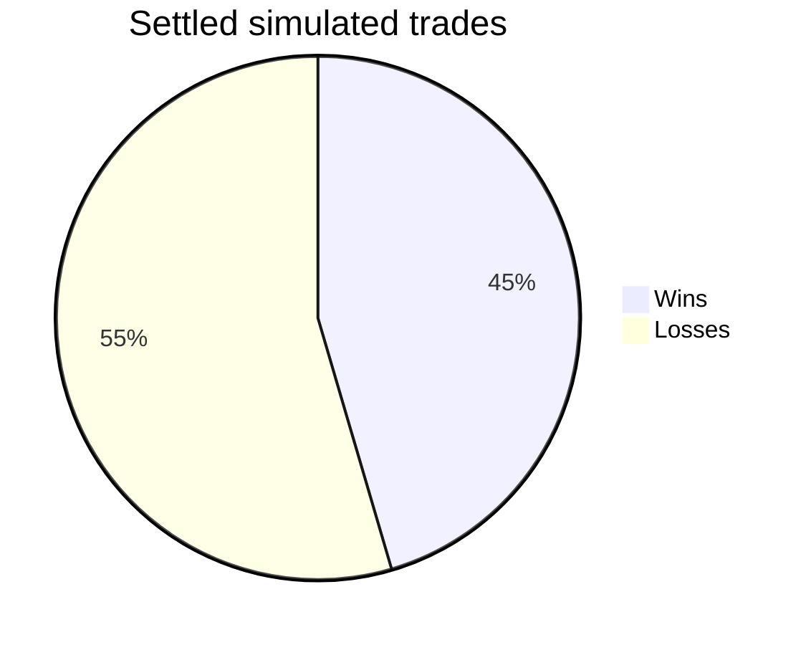

# btc_momentum

Paper account · simulated orders

| Metric | Value |
|---|---:|
| Cash | $83.83 |
| Reserved | $0.00 |
| Realized P&L | $-3.71 |
| Settled wins / losses | 5 / 6 |
| Open positions | 6 |
| Pending orders | 0 |
| Orders filled / placed | 25 / 26 |
| Recorded exit fees | $0.8096 |
| Calibration markets | 28 |
| Calibration logit offset | -0.1342 |
| Brier (markets) | 0.1112 (30) |
| ΔBrier vs market | +0.0027 |

[Order ledger](../../data/ledgers/btc_momentum-orders.csv) · [Trade ledger](../../data/ledgers/btc_momentum-trades.csv) · [Overview](../../REPORT.md)

## Results by market horizon

| Horizon | Closed trades | Realized P&L |
|---|---:|---:|
| 15m | 5 | $+0.63 |
| 1h | 6 | $-4.34 |

## Research

The shared research candidate is evaluated separately; it is not deployed to this account. [Latest experiments](../research/latest.md) · [Research plan](../RESEARCH.md)

Limit fills are estimates based on later observed book crossings; queue priority is unknown.
