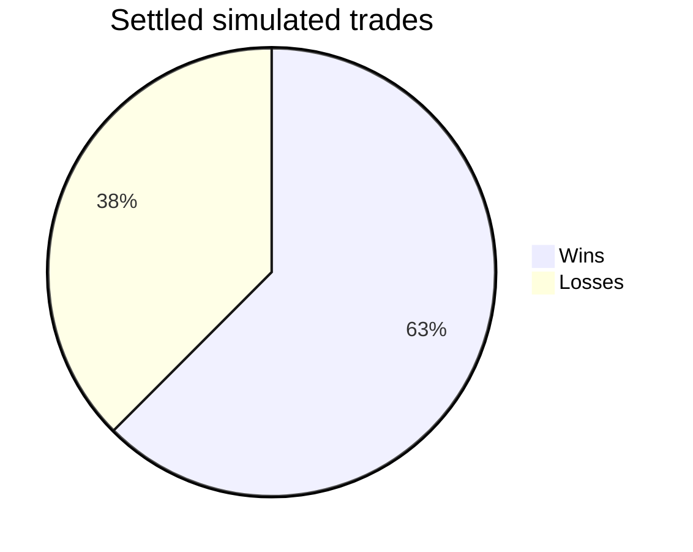

# btc_momentum

Paper account · simulated orders

| Metric | Value |
|---|---:|
| Cash | $100.34 |
| Reserved | $3.79 |
| Realized P&L | $+4.60 |
| Settled wins / losses | 5 / 3 |
| Open positions | 1 |
| Pending orders | 1 |
| Orders filled / placed | 15 / 16 |
| Recorded exit fees | $0.6009 |
| Calibration markets | 15 |
| Calibration logit offset | -0.0072 |
| Brier (markets) | 0.0895 (17) |
| ΔBrier vs market | +0.0032 |

[Order ledger](../../data/ledgers/btc_momentum-orders.csv) · [Trade ledger](../../data/ledgers/btc_momentum-trades.csv) · [Overview](../../REPORT.md)

## Results by market horizon

| Horizon | Closed trades | Realized P&L |
|---|---:|---:|
| 15m | 3 | $+4.68 |
| 1h | 5 | $-0.08 |

## Research

The shared research candidate is evaluated separately; it is not deployed to this account. [Latest experiments](../research/latest.md) · [Research plan](../RESEARCH.md)

Limit fills are estimates based on later observed book crossings; queue priority is unknown.
