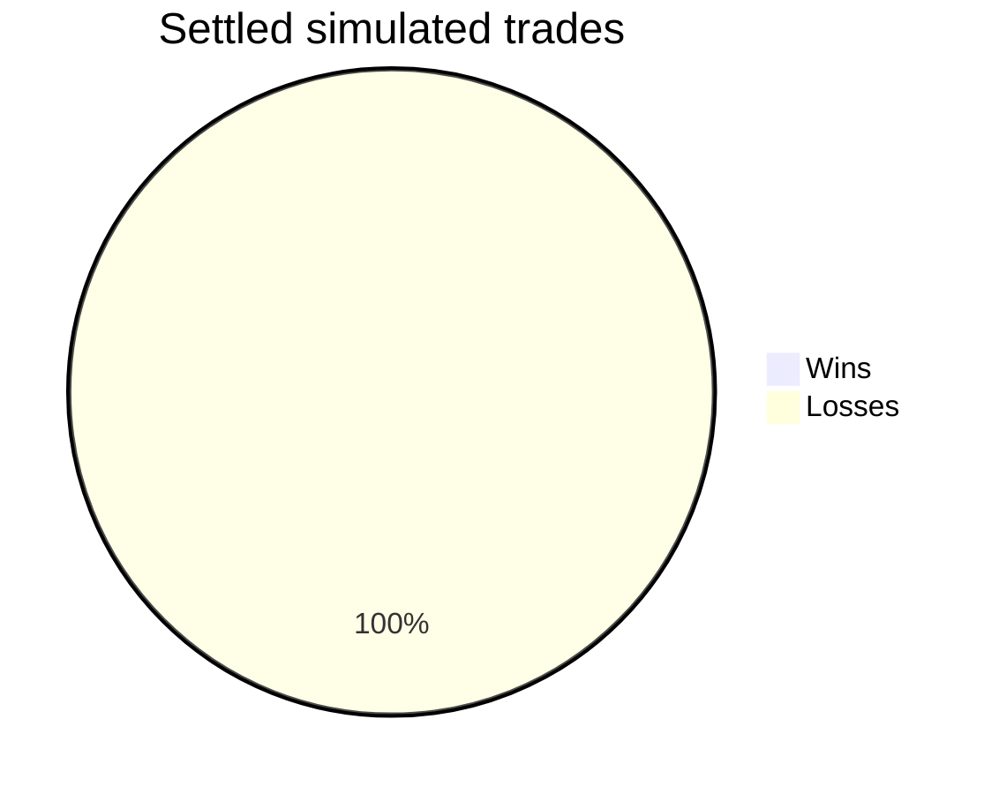

# btc_reversion

Paper account · simulated orders

| Metric | Value |
|---|---:|
| Cash | $86.80 |
| Reserved | $0.00 |
| Realized P&L | $-5.00 |
| Settled wins / losses | 0 / 1 |
| Open positions | 1 |
| Pending limits | 0 |
| Brier (markets) | 0.1029 (2) |
| ΔBrier vs market | -0.0110 |

[Order ledger](../../data/ledgers/btc_reversion-orders.csv) · [Trade ledger](../../data/ledgers/btc_reversion-trades.csv) · [Overview](../../REPORT.md)

Limit fills are estimates based on later observed book crossings; queue priority is unknown.
