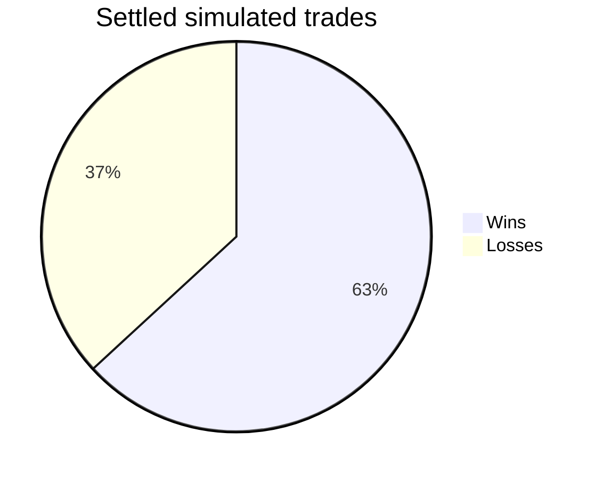

# btc_reversion

Paper account · simulated orders

| Metric | Value |
|---|---:|
| Cash | $97.49 |
| Reserved | $1.92 |
| Realized P&L | $+6.02 |
| Settled wins / losses | 12 / 7 |
| Open positions | 4 |
| Pending orders | 1 |
| Orders filled / placed | 31 / 34 |
| Recorded exit fees | $0.6356 |
| Calibration markets | 28 |
| Calibration logit offset | -0.1444 |
| Brier (markets) | 0.1137 (30) |
| ΔBrier vs market | +0.0001 |

[Order ledger](../../data/ledgers/btc_reversion-orders.csv) · [Trade ledger](../../data/ledgers/btc_reversion-trades.csv) · [Overview](../../REPORT.md)

## Results by market horizon

| Horizon | Closed trades | Realized P&L |
|---|---:|---:|
| 15m | 7 | $-4.19 |
| 1h | 12 | $+10.21 |

## Research

The shared research candidate is evaluated separately; it is not deployed to this account. [Latest experiments](../research/latest.md) · [Research plan](../RESEARCH.md)

Limit fills are estimates based on later observed book crossings; queue priority is unknown.
