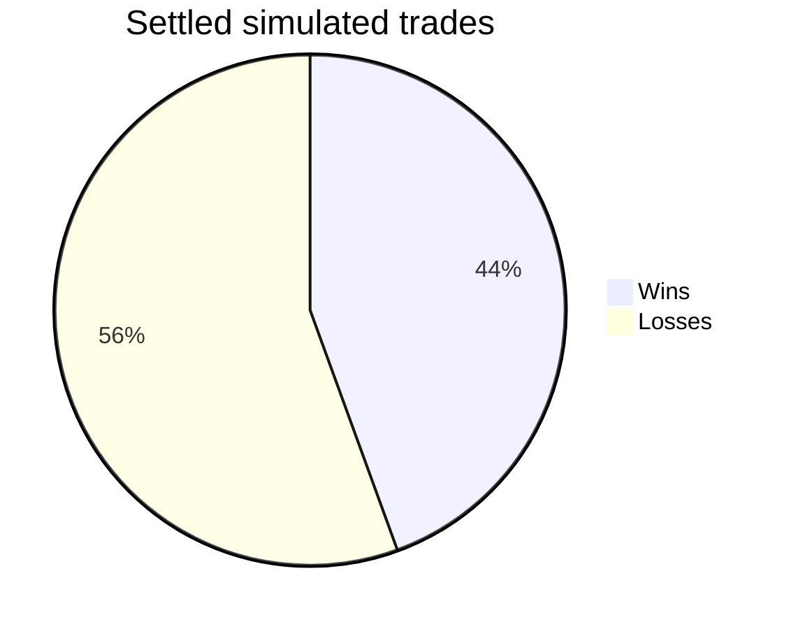

# btc_reversion

Paper account · simulated orders

| Metric | Value |
|---|---:|
| Cash | $79.64 |
| Reserved | $1.94 |
| Realized P&L | $-16.10 |
| Settled wins / losses | 4 / 5 |
| Open positions | 2 |
| Pending orders | 1 |
| Orders filled / placed | 17 / 18 |
| Recorded exit fees | $0.4954 |
| Calibration markets | 15 |
| Calibration logit offset | -0.0156 |
| Brier (markets) | 0.0970 (17) |
| ΔBrier vs market | -0.0043 |

[Order ledger](../../data/ledgers/btc_reversion-orders.csv) · [Trade ledger](../../data/ledgers/btc_reversion-trades.csv) · [Overview](../../REPORT.md)

## Results by market horizon

| Horizon | Closed trades | Realized P&L |
|---|---:|---:|
| 15m | 3 | $-14.96 |
| 1h | 6 | $-1.14 |

## Research

The shared research candidate is evaluated separately; it is not deployed to this account. [Latest experiments](../research/latest.md) · [Research plan](../RESEARCH.md)

Limit fills are estimates based on later observed book crossings; queue priority is unknown.
