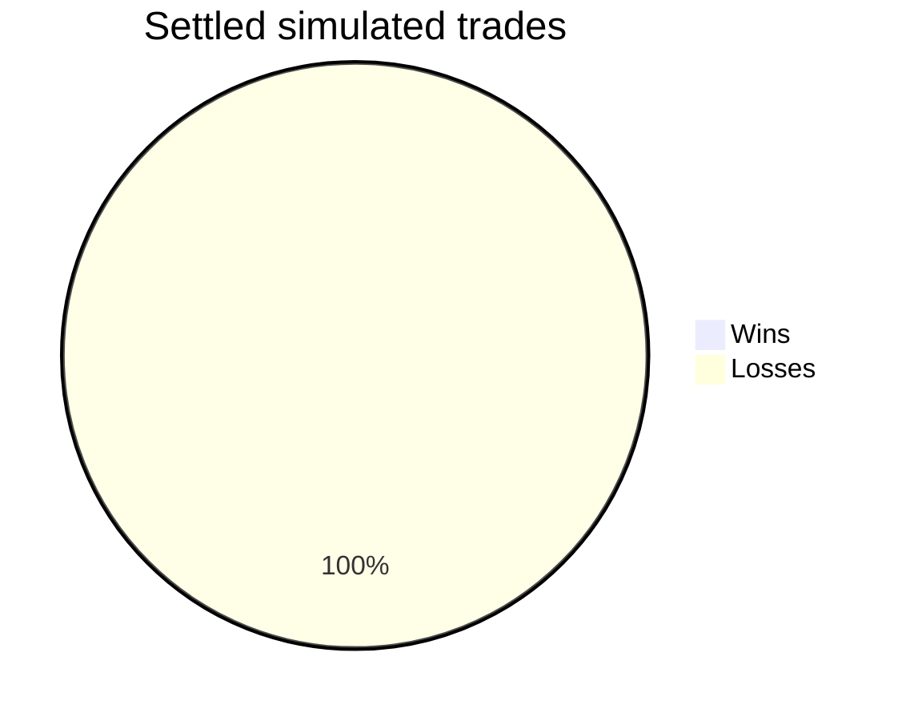

# conv_gru

Paper account · simulated orders

| Metric | Value |
|---|---:|
| Cash | $95.00 |
| Reserved | $0.00 |
| Realized P&L | $-5.00 |
| Settled wins / losses | 0 / 1 |
| Open positions | 0 |
| Pending orders | 0 |
| Orders filled / placed | 0 / 0 |
| Recorded exit fees | $0.0000 |
| Calibration markets | 0 |
| Calibration logit offset | +0.0000 |
| Brier (markets) | 0.2163 (1) |
| ΔBrier vs market | -0.0317 |

[Order ledger](../../data/ledgers/conv_gru-orders.csv) · [Trade ledger](../../data/ledgers/conv_gru-trades.csv) · [Overview](../../REPORT.md)

## Results by market horizon

| Horizon | Closed trades | Realized P&L |
|---|---:|---:|
| 15m | 1 | $-5.00 |
| 1h | 0 | $+0.00 |

## Research

The shared research candidate is evaluated separately; it is not deployed to this account. [Latest experiments](../research/latest.md) · [Research plan](../RESEARCH.md)

Limit fills are estimates based on later observed book crossings; queue priority is unknown.
