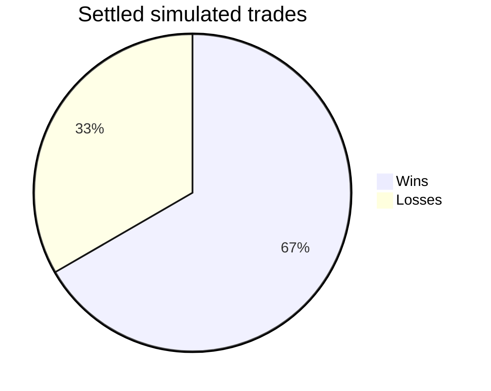

# cross_asset_momentum

Paper account · simulated orders

| Metric | Value |
|---|---:|
| Cash | $98.67 |
| Reserved | $3.30 |
| Realized P&L | $+2.39 |
| Settled wins / losses | 4 / 2 |
| Open positions | 1 |
| Pending orders | 1 |
| Orders filled / placed | 12 / 14 |
| Recorded exit fees | $0.4071 |
| Calibration markets | 15 |
| Calibration logit offset | -0.0071 |
| Brier (markets) | 0.0899 (17) |
| ΔBrier vs market | +0.0028 |

[Order ledger](../../data/ledgers/cross_asset_momentum-orders.csv) · [Trade ledger](../../data/ledgers/cross_asset_momentum-trades.csv) · [Overview](../../REPORT.md)

## Results by market horizon

| Horizon | Closed trades | Realized P&L |
|---|---:|---:|
| 15m | 2 | $+1.15 |
| 1h | 4 | $+1.24 |

## Research

The shared research candidate is evaluated separately; it is not deployed to this account. [Latest experiments](../research/latest.md) · [Research plan](../RESEARCH.md)

Limit fills are estimates based on later observed book crossings; queue priority is unknown.
