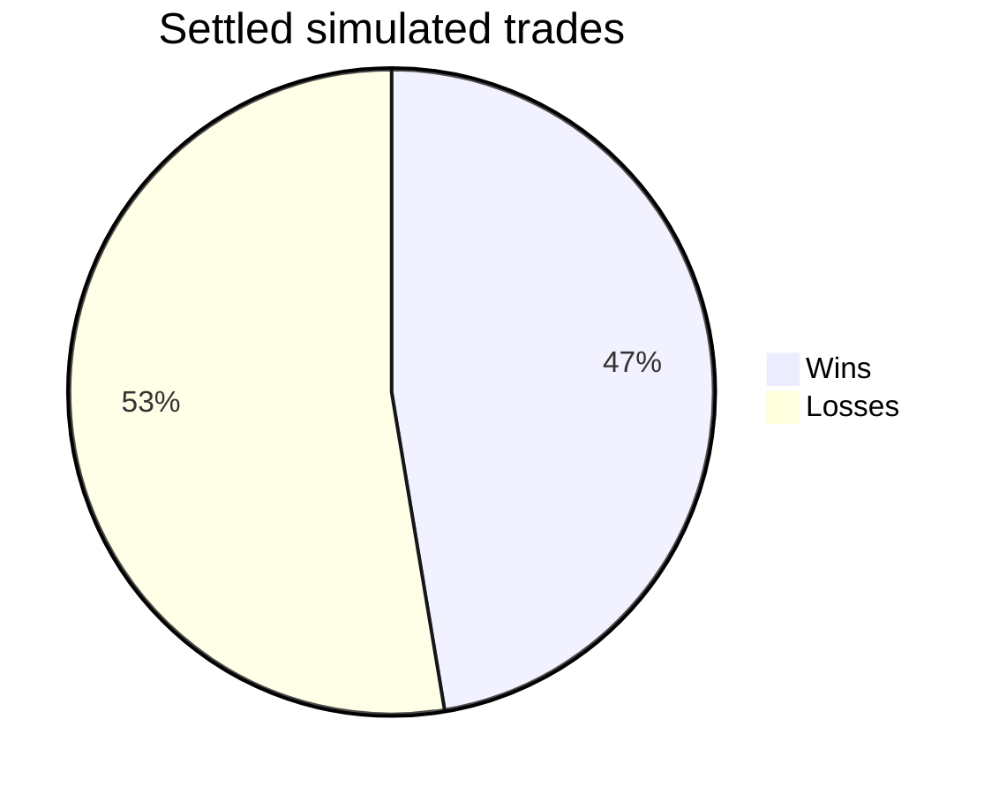

# research_linear

Paper account · simulated orders

| Metric | Value |
|---|---:|
| Cash | $76.03 |
| Reserved | $2.92 |
| Realized P&L | $+2.18 |
| Settled wins / losses | 9 / 10 |
| Open positions | 9 |
| Pending orders | 1 |
| Orders filled / placed | 29 / 30 |
| Recorded exit fees | $0.0138 |
| Calibration markets | 11 |
| Calibration logit offset | -0.0395 |
| Brier (markets) | 0.0890 (11) |
| ΔBrier vs market | -0.0015 |

[Order ledger](../../data/ledgers/research_linear-orders.csv) · [Trade ledger](../../data/ledgers/research_linear-trades.csv) · [Overview](../../REPORT.md)

## Results by market horizon

| Horizon | Closed trades | Realized P&L |
|---|---:|---:|
| 15m | 10 | $-23.61 |
| 1h | 9 | $+25.79 |

## Research

The shared research candidate is evaluated separately; it is not deployed to this account. [Latest experiments](../research/latest.md) · [Research plan](../RESEARCH.md)

Limit fills are estimates based on later observed book crossings; queue priority is unknown.
