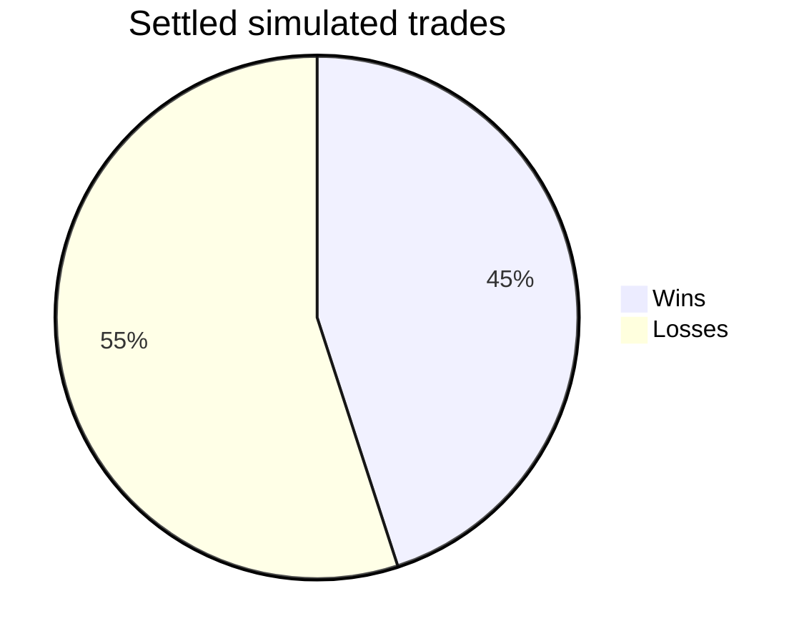

# research_linear

Paper account · simulated orders

| Metric | Value |
|---|---:|
| Cash | $67.04 |
| Reserved | $2.13 |
| Realized P&L | $-7.27 |
| Settled wins / losses | 18 / 22 |
| Open positions | 14 |
| Pending orders | 1 |
| Orders filled / placed | 56 / 65 |
| Recorded exit fees | $0.0650 |
| Calibration markets | 24 |
| Calibration logit offset | -0.1500 |
| Brier (markets) | 0.1149 (24) |
| ΔBrier vs market | +0.0019 |

[Order ledger](../../data/ledgers/research_linear-orders.csv) · [Trade ledger](../../data/ledgers/research_linear-trades.csv) · [Overview](../../REPORT.md)

## Results by market horizon

| Horizon | Closed trades | Realized P&L |
|---|---:|---:|
| 15m | 22 | $-6.92 |
| 1h | 18 | $-0.35 |

## Research

The shared research candidate is evaluated separately; it is not deployed to this account. [Latest experiments](../research/latest.md) · [Research plan](../RESEARCH.md)

Limit fills are estimates based on later observed book crossings; queue priority is unknown.
