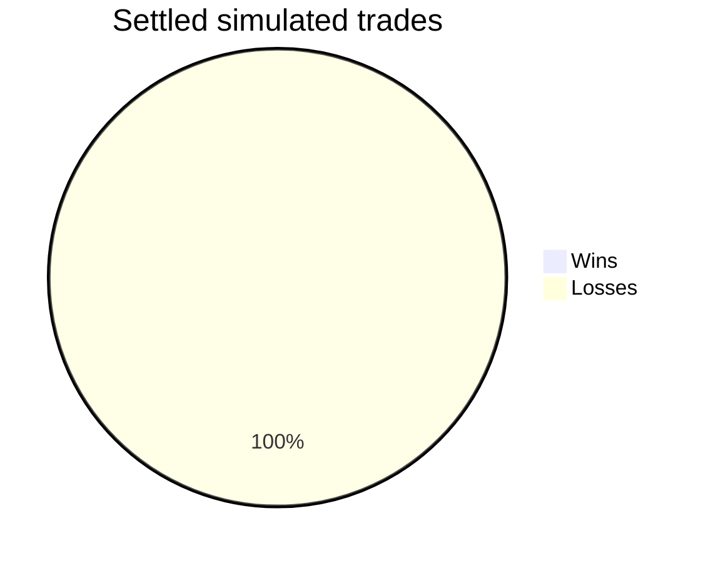

# skip_gru_2

Paper account · simulated orders

| Metric | Value |
|---|---:|
| Cash | $95.00 |
| Reserved | $0.00 |
| Realized P&L | $-5.00 |
| Settled wins / losses | 0 / 1 |
| Open positions | 0 |
| Pending limits | 0 |
| Brier (markets) | 0.2560 (1) |
| ΔBrier vs market | -0.0714 |

[Order ledger](../../data/ledgers/skip_gru_2-orders.csv) · [Trade ledger](../../data/ledgers/skip_gru_2-trades.csv) · [Overview](../../REPORT.md)

Limit fills are estimates based on later observed book crossings; queue priority is unknown.
